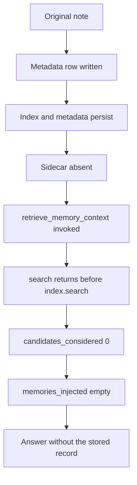

# FeralEcho Memory Retrieval Failure

**Date:** 2026-11-09
**Type:** Investigation-only
**Worktree:** `/Users/richietate/Desktop/FeralEcho-voyager`, branch `project-voyager`
**Production tree inspected, not modified:** `/Users/richietate/Desktop/FeralEcho`

## Question

Why did all ten facts from the 2026-11-09 evidence-to-answer experiment persist, and then fail to appear in delayed retrieval (`candidates_considered` 0, `memories_injected` `[]`)?

Falsifier: any of the ten delayed traces with `candidates_considered` greater than 0, a request-time log line showing `index.search` results for that turn, or a valid `memory/faiss.index.identity.json` bound to the index that process was searching.

## Hypotheses

| ID | Hypothesis | Result |
|---|---|---|
| H0 | Storage never committed the ten facts. | DISPROVEN. The ten user rows are in metadata, text equal to the Phase One prompts. |
| H1 | The rows are in metadata, and the identity sidecar required for search is absent, so `VectorMemory.search` returns `[]` before `index.search`. | Favored. OBSERVED in source and in the request logs. |
| H2 | Search ran and the 30-minute recency filter removed every hit. | DISPROVEN for this outage. |
| H3 | Search ran and the correct row ranked below k. | DISPROVEN. No candidate list was produced. |
| H4 | An exception in retrieval swallowed the result and skipped provenance. | DISPROVEN. Provenance lines exist, and the refusal warning is the log that fired. |
| H5 | The index was empty. | DISPROVEN at the logged loads and by the absence of the empty-index log during the experiment windows. |
| H6 | The answering model received the fact and ignored it. | DISPROVEN for the memory payload. `memories_injected` is empty. Item 05's `no` is a closed-set answer on an empty injection list. |

## Scope / Non-goals

This mission reconstructs the ten-fact retrieval chain and designs a repair. It does not implement that repair, run it, restart Echo, write a sidecar, load the live FAISS index into the running process, spend the two unused generations, or edit the sealed evidence-to-answer protocol or its finished score report.

The skill's default report path is `audits/<date>_<slug>.md`. This assignment specifies the path under `voyager_lab/memory_retrieval_forensics_2026-11/`. That specified path is the one used.

Learning-loop classification (L0–L3) does not apply. The claim under test is retrieval, not adaptation.

---

## 1. Executive summary

Echo stored all ten facts as `user_conversation` user rows whose text matches the Phase One note. Delayed retrieval returned no candidates for any of the ten questions. The break is the identity gate in `VectorMemory.search`. The live store has no `memory/faiss.index.identity.json`. On the process that served the experiment, that status was `manifest_absent` and `verified=False` from boot. Search then returns an empty list before FAISS `index.search`. Provenance records that empty list as `candidates_considered` 0 and `memories_injected` `[]`. The 30-minute filter, the k=5 cut, and the answering model never saw these ten records.

The same refusal covers every retrieval since `2026-10-29T02:21:39.525310`, not only these ten questions. Same-turn answers of 8/10 were produced from the note inside the user message. Those turns also logged `candidates_considered` 0.

Whether each of the ten uuids is a numeric row inside the FAISS file remains UNKNOWN. Metadata presence is not vector identity. That gap does not explain the empty candidate lists. The refusal fires before any row is read.

Classification for all ten delayed failures: **S1**. The required retrieval structure is the verified identity manifest plus a trusted `id_order`. That structure does not contain these records. Origin class: **E** (identity / metadata). Incomplete indexing (class A) is the same fact.

The smallest credible correction is an offline copy that becomes one authoritative generation: index bytes and a sidecar written together from a real `id_order`. The first step is a byte-prefix check against the already-built certified store. A full re-embed of the copy is the branch only if that prefix check fails. Do not certify `memory_meta.json` key order. Do not install the 2026-11-02 suffix freeze over the live files. Do not disable the refusal.

The retrieval-proof experiment uses **0** generations. It is not authorized by this report.

### The twelve questions

1. **Did Echo store all ten facts?** Yes. (OBSERVED in `memory/memory_meta.json` after the experiment; VERIFIED at score time by the finished attribution.)
2. **Were all ten indexed?** They are in metadata. They are absent from the identity sidecar, because that file is absent for the whole store. Whether each uuid is a FAISS vector row is UNKNOWN.
3. **Was retrieval invoked for all ten delayed questions?** Yes. `retrieve_memory_context` ran, provenance lines were written, and each request logged the refusal. FAISS `index.search` did not run.
4. **Could the correct records be found through the existing search path?** No, while identity is unverified. `VectorMemory.search` returns `[]` before lookup. (OBSERVED on these twenty requests, ten same-turn and ten delayed.)
5. **If found, were they accepted and ranked?** Nothing was returned. Ranking and the recency filter did not run.
6. **Did the correct records reach the answering model?** No. `memories_injected` is `[]`. The Phase Two user message does not contain the fact.
7. **Where did the chain break?** After persistence, at identity. Stored text exists. The sidecar is absent. Search refuses. Candidates are 0. Nothing is injected. The model answers without the record.
8. **Is the failure reproducible from existing evidence?** Yes for the refusal. Per-id FAISS membership is the remaining unknown and is not required to explain the empty lists.
9. **What is the smallest credible correction?** On a copy, build one authoritative index plus sidecar from a real row order. Prefer a proven byte-prefix append onto the existing certified store. Re-embed the copy only if that proof fails.
10. **What experiment would prove it?** The unrun copy-only diagnostic in section 14. Success is the ten user-record ids in search hits and their text hashes in a simulated injected context. Answer accuracy is a separate, later measurement.
11. **What should stay unchanged?** The refusal, the validator, k, the 30-minute filter, FAISS as the engine, the sealed protocol, the finished evidence report, and the live index and sidecar while the writer is active.
12. **What is the next single research priority?** Authorize the copy-only diagnostic. Spend 0 generations on the retrieval proof. Do not cut the copy over, and do not restart the listener, inside that authorization.

---

## 2. Verified experimental baseline

Source report, left unchanged: `voyager_lab/evidence_to_answer_2026-11/FERALECHO_EVIDENCE_TO_ANSWER_EXPERIMENT.md`.

| Measure | Result | Label |
|---|---|---|
| Same-turn evidence use | 8/10 | VERIFIED by `phase1_scores.json` in the finished run |
| Persistent storage | 10/10 | VERIFIED at score time; re-OBSERVED in metadata |
| Delayed retrieval | 0/10 | OBSERVED: each delayed trace has `candidates_considered` 0 and `memories_injected` `[]` |
| Delayed answer matches | 1/10 | VERIFIED. Only item 05, key `no`. Retrieved No. |
| Generations | 20/22 | OBSERVED in `run_meta_phase2.json` (`posts_used_total` 20, `contingency` 0) |
| Delay | 1860 seconds | OBSERVED. Deadline `2026-11-09T22:33:34.185489+00:00`. First Phase Two POST `2026-11-09T22:33:34.219739+00:00` |
| Infrastructure failures | none | OBSERVED. HTTP 200, `infra` false, on all 20 rows |
| Retries, production edits, extra generations | none in that run | OBSERVED from the finished run record |

Pathway: Echo Studio `POST /chat/stream`, mode `fast`, model `echo:latest`. Fast mode calls `stream_query_ollama` with the raw user message as the user turn. Memory, history, ground truth, and tool context are system-note material (`app/routes_echo_studio.py` `_build_full_prompt`, lines 76–125).

The finished evidence report left the zero-candidate mechanism UNKNOWN between an empty search and the 30-minute filter. This investigation resolves that split. It does not rewrite that report. The prior claim remains the historical record of what was known when that report was sealed by its own assignment.

Item 05's delayed `no` is a closed-set answer. It is not retrieval evidence. (OBSERVED: its provenance row has an empty injected list.)

---

## 3. Ten-fact evidence reconstruction

Public prompts: `voyager_lab/evidence_to_answer_2026-11/items.json`. Each stored user row's text equals `phase1_prompt` (`exact_prompt` true on the metadata read). Conversation ids `e2a-p1-*` and `e2a-p2-*` are not stored inside `memory_meta.json`.

Phase One prompt shape: `Note: {fact}` plus the question plus the value tail. Phase Two prompt shape: `Question: {question}` plus the tail. The fact sentence is not in the delayed user message.

Shared tails: value items use `Reply with only the value...`. Item 05 uses `Reply with only the lowercase word yes or no.` on both phases.

### Per-fact identity

Hashes are SHA-1 hex, first 12 characters, of the stored user text. That is the provenance hash function at `app/core/conversation_service.py` line 173. A 12-hex prefix is 48 bits. Collision risk is a recorded limitation of the log, not a finding that any of these ten collided.

| Item | Fact | Key | User memory id | Stored timestamp (UTC) | Hash | Text length |
|---|---|---|---|---|---|---|
| 01 | The dock badge mark is K7-QRV-4419. | `K7-QRV-4419` | `5e6ac8a9-19c1-4fcd-b08e-dd7c0f5e659b` | `2026-11-09T21:58:28.196230+00:00` | `5aeece192c0e` | 162 |
| 02 | Crate 14 has a mass of 18.6 kilograms. | `18.6 kilograms` | `aded2053-b5d9-42d5-a106-aa3773f60ea5` | `2026-11-09T21:58:51.809328+00:00` | `f6e677371d0d` | 166 |
| 03 | Helio reports to Sable. | `Sable` | `36495cc5-39f3-4a31-a79b-332dc52da1ae` | `2026-11-09T21:59:10.616709+00:00` | `254ada88570e` | 147 |
| 04 | Permit P-19 has the seal date 2026-04-17. | `2026-04-17` | `90e3838a-c12d-4a28-a653-b5de13471e0e` | `2026-11-09T22:01:14.061924+00:00` | `e71037e8fcdc` | 177 |
| 05 | Lane 4 is not closed. | `no` | `accc4c1e-ef05-466f-8ef2-4f1b997166f8` | `2026-11-09T22:01:25.644398+00:00` | `02d0c62ade8b` | 103 |
| 06 | Vat B contains more liquid than vat A. | `Vat B` | `c86b2d32-5438-4c52-b7ae-df291cca4db2` | `2026-11-09T22:01:30.808760+00:00` | `31bc63a1affe` | 168 |
| 07 | The gold items sit on shelf 22. | `22` | `2dd6c6ec-1afe-47e6-9739-883eb12efc98` | `2026-11-09T22:01:34.418744+00:00` | `3c63d277f342` | 168 |
| 08 | The bin total at dock C is 4. | `4` | `1f366a17-832a-4eb0-a5e4-0458f1d85fde` | `2026-11-09T22:01:38.496511+00:00` | `4ba1c6a1d6a0` | 156 |
| 09 | The night passphrase is moth-lantern. | `moth-lantern` | `0192ec01-8404-4f02-a2ce-c8dc4c53f848` | `2026-11-09T22:02:20.231273+00:00` | `72040f561398` | 165 |
| 10 | The shipment block mark is R-88. | `R-88` | `dd44ed20-1acb-4951-8335-33437b6947d3` | `2026-11-09T22:02:31.194483+00:00` | `479cfd462810` | 163 |

Metadata on every user row: `role` `user`, `memory_source` `user_conversation`, `task_type` `general`. (OBSERVED.)

Item 03 has a second row. Echo id `67eccddb-cb98-4373-b206-aceed4712b62`, timestamp `2026-11-09T21:59:14.436285+00:00`, hash `4ae0ccf0ce68`, length 23, text `Helio reports to Sable.` That is the same-turn miss stored as the echo reply. It was also absent from delayed retrieval. Fact-sentence counts in the metadata read: items 01, 02, and 04–10 once each; item 03 twice.

### Delayed questions, provenance, and refusal log

Provenance timestamps are naive. The writer is `datetime.utcnow().isoformat()` at `app/routes_echo_studio.py` line 444. Production retrieval treats naive timestamps as UTC. The experiment's storage scorer rejects naive timestamps. Retrieval scoring matched `trace_id`.

Watchdog timestamps below are local Pacific (UTC−8), `process_request_thread`, message `[VectorMemory] search refused: identity_status=manifest_absent`. Log file: `/Users/richietate/Desktop/FeralEcho/memory/echo_watchdog.log`. The refusal is logged at prompt build. The provenance timestamp is near request end. Both exist for every experiment turn.

| Item | Phase Two trace | Provenance timestamp | Refusal log (local) | Log line | Delayed answer | Match |
|---|---|---|---|---|---|---|
| 01 | `dfdbb22d-2eb5-44eb-8139-4799facfe653` | `2026-11-09T22:33:53.232960` | `2026-11-09 14:33:34` Thread-182870 | 73706 | scripture verse, not the badge | no |
| 02 | `61b329ab-1305-42d2-951c-795438568598` | `2026-11-09T22:34:03.855429` | `14:33:56` Thread-182882 | 73738 | `1.45` | no |
| 03 | `4bb23150-547f-48f9-a11f-826d92a2f0ab` | `2026-11-09T22:35:15.823387` | `14:34:06` Thread-182890 | 73762 | `Sergio` | no |
| 04 | `140a6073-eff7-4894-be5f-496375ba24e0` | `2026-11-09T22:35:36.833058` | `14:35:19` Thread-182929 | 73833 | `February 26, 2004` | no |
| 05 | `727a8d33-92bc-4948-a3b5-2021b1754244` | `2026-11-09T22:35:40.827288` | `14:35:40` Thread-182945 | 73866 | `no` | yes, retrieval no |
| 06 | `fea4e80e-87fb-492c-b162-9972585677e4` | `2026-11-09T22:35:46.131214` | `14:35:44` Thread-182949 | 73877 | `Vat 1` | no |
| 07 | `3136546c-8290-4859-9652-cb09ce7bec67` | `2026-11-09T22:35:49.616489` | `14:35:49` Thread-182953 | 73898 | `5` | no |
| 08 | `ee351b95-dd90-4a23-9039-ed89b0343540` | `2026-11-09T22:35:53.709905` | `14:35:53` Thread-182958 | 73908 | `12` | no |
| 09 | `16c8dfa7-2b65-477a-8724-1b6d01abb489` | `2026-11-09T22:35:58.427114` | `14:35:56` Thread-182960 | 73922 | `wonderfully` | no |
| 10 | `4ac1cd03-58d9-4602-85fd-7e8d74491caf` | `2026-11-09T22:36:01.955058` | `14:36:01` Thread-182967 | 73937 | `X12` | no |

One later refusal at line 73990, `14:36:40`, Thread-8 (`emergent_loop`), is outside the ten. Phase Two finished `2026-11-09T22:36:10.190965+00:00` (14:36:10 local).

Phase One also refused, on the same gate, while the fact was still in the user message. Those traces, all `candidates_considered` 0: `fd69a6f1-1d67-44ac-8343-6388723f9918`, `5d5f5da7-cfc9-4a87-bcff-4f5765c4050c`, `acc943d8-96d1-430e-88c1-b9863b8cd0c5`, `e653b7b1-74ff-4e30-8066-98dfb178f239`, `57cbfffa-2b78-4d4b-8db3-e8ea142e734f`, `9d50fc7b-3af2-44d3-b9a1-0c00d0041723`, `f5130bc7-f759-4914-8b8c-dd20defcdb61`, `b2267c9a-8c3f-4658-af65-9bb0d585a233`, `cc8b1af7-1b97-4d00-b5e4-76cc47ef7fff`, `9183b39e-1d09-4b10-8a53-028280940abf`. Local refusal lines 71633, 71669, 71697, 71730, 71839, 71860, 71876, 71889, 71901, 71979.

Age at the delayed question: item 01 about 35 minutes 25 seconds; item 10 about 33 minutes 30 seconds. All ten user rows are older than 30 minutes. If they had been hits, the recency filter would have kept them. They were not hits.

---

## 4. Storage verification

Write path (SUPPORTED by source, OBSERVED by the resulting rows):

1. Fast-mode chat calls `save_turn_to_server` (`app/routes_echo_studio.py`).
2. The server handler calls `add_to_vector_memory` for the user text and the echo text, source `user_conversation`.
3. `add_to_vector_memory` (`app/core/memory_bridge.py` lines 365–401) runs the validator, replaces the timestamp with `datetime.now(timezone.utc).isoformat()`, mints a new uuid, embeds the text, and calls `vector_memory.add` under `memory_lock`.
4. `accepted` means `_persist()` returned True. The function's own docstring says that does not mean `ntotal` increased and does not mean a later retrieval will find the text.

The ten user rows are the authoritative storage evidence. Text equals the Phase One prompt. Hashes match the attribution hashes from the finished run. Timestamps carry `+00:00`. (OBSERVED on a `json.load` of one complete generation: file size 136,417,765 bytes, 157,412 dict keys. That generation is later than the 18:54:31 local stat of 136,414,279 bytes. The writer was still replacing the file. These sizes are not a frozen census.)

SSE `memory_save` was `unknown`/`unknown` on 19 of 20 turns, and `accepted`/`accepted` on Phase Two item 02. Storage Yes still holds, because the rows are in metadata. The unknown SSE field is an instrumentation gap on the HTTP wait. It is not a failed write. (SUPPORTED. The client wait is short relative to rewriting the index and the metadata twice per turn. The exact client timeout number was not re-read in the write-up turn.)

No normalization of the fact sentence was found in the stored user text. The stored string is the whole Phase One prompt, not a summary of the fact. Item 03's echo row is the fact sentence alone, which is the model's same-turn reply, stored as its own record.

---

## 5. Indexing verification

Three structures are separate.

| Structure | State for these ten | Label |
|---|---|---|
| `memory/memory_meta.json` | All ten user ids present, text intact | OBSERVED |
| `memory/faiss.index` | File present and still being rewritten. Not opened. `ntotal` not read | UNKNOWN per id |
| `memory/faiss.index.identity.json` | Absent. `find` under `/Users/richietate/Desktop/FeralEcho` returned no FAISS sidecar | OBSERVED |

`VectorMemory._load_metadata` sets `id_order = list(self.meta.keys())` (line 88). That list is provisional. `_apply_identity_manifest` (lines 242–274) leaves an existing index unverified when the sidecar is missing: `identity_status` `manifest_absent`, `identity_verified` False, `_identity_authoritative` False. `_persist` (lines 342–401) writes metadata, then the index, then the sidecar only when `_identity_authoritative and wrote_index` (lines 389–395). A legacy unverified store therefore keeps growing metadata and the index and never writes a sidecar. Search stays refused for the process lifetime.

Boot of the listener process, from `memory/echo_watchdog.log.1.gz`: `2026-11-03 11:01:59` local loaded metadata, loaded FAISS index dimension 384, then `identity_status=manifest_absent verified=False`. A second load at 11:03:17 and `awareness_loop` at 11:03:46 repeat `manifest_absent verified=False`. `ntotal mismatch` count is 0 in that gzip and 0 in the current log. The mismatch warning fires only when `index.ntotal != len(self.meta)` (lines 105–110). (SUPPORTED: at the logged loads, the counts matched. That does not make JSON key order a trusted map, and it does not prove every later persist stayed aligned.)

`add()` (lines 174–193) embeds and calls `index.add` for a new id, then appends that id to `id_order`, then `_persist()`. A duplicate id updates metadata and does not append a second vector. The ten ids are new uuids, so the add path is the append path. (SUPPORTED by source. Per-id presence inside the on-disk index remains UNKNOWN, because there is no trusted `id_order` and `ntotal` was not read.)

Nov 8 morning persist logs reported 156,505 through 156,509 vectors equal to meta length. Those lines predate the experiment. They are not the experiment-time count and not the later 157,412-key read.

Arithmetic note, not a measured `ntotal`: 157,412 × 384 × 4 = 241,784,832. The index file at one stat was 241,783,341 bytes, about 1,491 bytes smaller, which is consistent with a FAISS header. Dimension 384 is OBSERVED from the Nov 3 load log. It was not re-read from the header in this mission.

A certified recovery directory still exists at `/Users/richietate/Desktop/FeralEcho-offline-recovery-20261026/suffix-recovery-20261102`. This mission did not re-hash its index. The historical recovery note describes a 2026-11-02 freeze of 151,898 re-embedded rows. That generation is behind the live writer. Installing it over live memory would omit the ten facts and everything stored after `2026-11-02T03:50:52Z`. It is an input to the copy-only prefix check. It is not a cutover artifact.

---

## 6. Search execution analysis

Call chain for every fast-mode turn (SUPPORTED by source, OBSERVED by the refusal log and the provenance rows):

1. `_build_full_prompt` always calls `retrieve_memory_context(msg, _memory_search_fn, provenance_out=...)` (`app/routes_echo_studio.py` lines 100–102).
2. `retrieve_memory_context` calls `search_fn(msg, k * 3)` with default `k` 5, so the adapter is asked for 15 (`app/core/conversation_service.py` line 119).
3. `_memory_search_fn` calls `retrieve_relevant_memories(query, top_k=k)` (`app/routes_echo_studio.py` lines 52–64). The studio caller does not pass `source_filter`, so `fetch_k` stays equal to that 15. It is not multiplied by 3 a second time (`app/core/memory_bridge.py` line 461).
4. `retrieve_relevant_memories` embeds the query, optionally blends a workspace-bias vector, then calls `vector_memory.search(qvec, k=fetch_k)` (line 462).
5. `VectorMemory.search` returns `[]` when `identity_verified` is false, and logs the refusal, before `self.index.search` (lines 209–227).

Two explicit empty branches in `retrieve_memory_context` both set `candidates_considered` 0 and `injected` `[]`: search returned empty (lines 120–124), or the 30-minute filter emptied the list (lines 132–136). The `except` path (lines 182–183) returns `""` and does not fill the provenance dict. The route writes provenance only when that dict is truthy (`app/routes_echo_studio.py` lines 440–450). An exception before the keys are set leaves the dict empty and writes no line.

All 20 experiment turns wrote a provenance line. The exception path did not produce these rows. The windows contain zero `FAISS index empty or uninitialized` lines, zero `[echo_studio] memory search failed` lines, and zero `Failed to retrieve memories` lines. They contain the identity refusal on `process_request_thread` for each turn. (OBSERVED.)

Workspace-bias activity on these turns is UNKNOWN. Bias is applied before `search()`. It cannot change a refusal that happens inside `search()` after the embedding step. A dimension mismatch would raise after the identity check and would have been logged as `Failed to retrieve memories`. That log is absent.

Provenance file census (OBSERVED): `memory/retrieval_provenance.jsonl`, 687 parseable lines, 0 unparseable, span `2026-09-03T00:00:21.856403` through `2026-11-09T22:36:01.955058`. `candidates_considered` 0 on 241 lines. Nonzero values 1–15 on 446 lines, including 284 lines at 15. Last nonzero: `2026-10-28T04:04:29.156643`, value 15, trace `47c0d7be-a8fb-4bb6-8f1d-cd75944401f5`. Trailing zero streak: 240 of 687, starting `2026-10-29T02:21:39.525310`. Every 2026-11-09 line is zero (59 of 59). Nov 9 `search refused` count in the current log: 449.

`query_preview_used` in the experiment scorer is hard-coded false. Phase Two previews in provenance start with `Question:`. Phase One previews start with `Note:`.

---

## 7. Candidate discovery and ranking analysis

For each of the ten delayed questions the candidate list is empty. (OBSERVED.)

| Stage | What the code would do with hits | What happened |
|---|---|---|
| FAISS `index.search` | Return neighbor ids | Did not run. Refusal returned first. |
| Identity map `id_order[idx]` | Name the metadata row | Did not run. |
| Role / source exclusion in `retrieve_relevant_memories` | Drop excluded categories | Did not run. Input list empty. |
| 30-minute filter | Drop hits newer than cutoff; keep a failed parse | Did not run. Input list empty. These ten user timestamps would have been kept if they had been hits. |
| `user_conversation` preference and `[:k]` | Keep up to 5 | Did not run. |

The empty list is branch 1 (search returned empty), not branch 2 (filter removed hits). A 30-minute filter cannot zero every neighbor, for weeks, on an index that loaded with a matching metadata count and has continued to grow.

---

## 8. Context-injection analysis

`_build_full_prompt` puts retrieval text into the system note through `build_context_system_note`. The user turn is the raw message only. (SUPPORTED by source.)

For all ten delayed turns, `memories_injected` is `[]`. (OBSERVED.) The Phase Two prompt template contains the question and the reply tail. It does not contain the fact. (OBSERVED from `items.json` and from provenance `query_preview`.)

The full system string sent to the model was not logged. A non-retrieval injection (scripture block, ground-truth slice, tool block, session history) is UNKNOWN for these turns. These questions do not match the introspective trigger that adds ground truth. (SUPPORTED by the `_is_introspective` gate. The actual string was not captured.)

Item 01's delayed answer quotes a scripture verse. Item 09's delayed answer is `wonderfully`. Those strings are not the stored facts. The injected memory list is empty on both turns. This investigation does not claim the verse was retrieved from item 01, and it does not claim item 09 read item 01's reply. Whether a scripture block was present in the system note is UNKNOWN.

Context assembly did not drop a retrieved record. There was no retrieved record to drop.

---

## 9. Ten individual failure classifications

Shared classification: **S1**. Storage succeeded. The identity sidecar, which search treats as a required retrieval structure, is absent. Confidence in the refusal mechanism: high. The residual UNKNOWN is per-id FAISS row membership. That unknown is the same for every item. It does not split the ten into different codes.

S2 would require that retrieval was not invoked. The function ran. S3 would require that `index.search` ran and missed. It did not run. S4 would require a hit that was filtered or ranked out. The filter did not run. S5 would require a retrieved candidate that was then left out of the prompt. Nothing was retrieved. S6 would require the fact in the model input. The memory payload was empty, and the user message did not contain the fact. Item 05 is not S6. S0 is false because the rows exist. S8 is false because the HTTP turns completed and the refusal is the designed gate, not a crash. S7 would apply if the empty list could not be assigned to a branch. The branch is identified.

Missing observability, named once: there is no trusted `id_order`, and `ntotal` was not read, so "bytes may exist in the index" and "this uuid is row N" are not the same claim. A log of neighbor ids was not produced, because search returned before that call.

| Item | Storage | Indexing | Search | Candidates | Context | Class | Confidence |
|---|---|---|---|---|---|---|---|
| 01 | user row `5e6ac8a9-19c1-4fcd-b08e-dd7c0f5e659b` | meta yes; sidecar no; FAISS row UNKNOWN | refusal line 73706 | 0 | injected `[]` | S1 | high |
| 02 | `aded2053-b5d9-42d5-a106-aa3773f60ea5` | same | line 73738 | 0 | `[]` | S1 | high |
| 03 | user `36495cc5-39f3-4a31-a79b-332dc52da1ae` plus echo `67eccddb-cb98-4373-b206-aceed4712b62` | same for both rows | line 73762 | 0 | `[]` | S1 | high |
| 04 | `90e3838a-c12d-4a28-a653-b5de13471e0e` | same | line 73833 | 0 | `[]` | S1 | high |
| 05 | `accc4c1e-ef05-466f-8ef2-4f1b997166f8` | same | line 73866 | 0 | `[]`; answer `no` is not retrieval | S1 | high |
| 06 | `c86b2d32-5438-4c52-b7ae-df291cca4db2` | same | line 73877 | 0 | `[]` | S1 | high |
| 07 | `2dd6c6ec-1afe-47e6-9739-883eb12efc98` | same | line 73898 | 0 | `[]` | S1 | high |
| 08 | `1f366a17-832a-4eb0-a5e4-0458f1d85fde` | same | line 73908 | 0 | `[]` | S1 | high |
| 09 | `0192ec01-8404-4f02-a2ce-c8dc4c53f848` | same | line 73922 | 0 | `[]` | S1 | high |
| 10 | `dd44ed20-1acb-4951-8335-33437b6947d3` | same | line 73937 | 0 | `[]` | S1 | high |

Exact sources: section 3 table; `memory/retrieval_provenance.jsonl` rows cited by trace id; `memory/echo_watchdog.log` lines cited above; `app/lib/vector_memory.py` lines 199–227 and 389–395.

---

## 10. Root-cause analysis

**Symptom:** delayed questions return no memories, and the model answers without the stored fact.

**Mechanism:** `VectorMemory.search` refuses lookup when `identity_verified` is false (`app/lib/vector_memory.py` lines 209–215). The live sidecar is absent, so status is `manifest_absent`. `_persist` will not create a sidecar for a store that was unverified at process start (lines 389–395). Later successful writes grow metadata and the index and leave the next search refused.

Origin letter: **E**. The missing manifest is an identity-structure failure. Class A (incomplete indexing) names the same missing sidecar. It is not a second independent bug. The failure is not semantic search quality, query wording, the embedding model, the 30-minute filter, k, context truncation, or the answering model.

Certifying `meta.keys()` as `id_order` would make search return text for the wrong historical rows. That is the mapping the gate exists to prevent. Counts matching at the Nov 3 load would still leave the historical prefix unlabeled. A correct tail alignment, if one existed, would not make the prefix trustworthy.

The outage is systemic. The ten facts are ten instances. Retrieval with `candidates_considered` 0 has been continuous since `2026-10-29T02:21:39.525310`.

---

## 11. Causal diagram

```text
Original note in the user message
  → memory extraction / write          VERIFIED at score time; OBSERVED rows remain
  → persistence of metadata text       OBSERVED (exact Phase One prompt)
  → embedding + index append           SUPPORTED by add(); per-id FAISS row UNKNOWN
  → identity sidecar                   FAILED (file absent; authoritative flag false)
  → search invocation                  OBSERVED (provenance + refusal log)
  → FAISS index.search                 FAILED to run (refusal returns first)
  → candidate list                     OBSERVED empty
  → ranking / 30-minute filter         DID NOT RUN
  → context injection of the record    OBSERVED absent
  → answer                             OBSERVED without the record
                                       (item 05 key match is a closed-set answer)
```



Verified arrows: A→B, B as text, E, F, G, H. Failed arrow: sidecar, and therefore FAISS lookup. Unknown arrow: uuid-to-vector row. The answer arrow is observed behavior. It is not evidence that memory was consulted.

---

## 12. Existing architectural strengths worth preserving

- The refusal returns empty results instead of naming vectors from JSON key order (`vector_memory.py` lines 199–215, and the persist comment at lines 346–348).
- The sidecar is written only for an order the process owns (lines 389–395).
- A crash between index replace and sidecar replace leaves search empty rather than guessing (lines 356–362).
- `_classify_manifest` checks schema, index hash, binding, `ntotal`, uniqueness, and metadata membership before trusting an order (lines 276–325).
- Duplicate ids do not append a second vector (lines 174–183).
- `add_to_vector_memory` documents that `accepted` is not retrieval (lines 371–375). The validator still gates the write.
- Provenance records hashes and counts, which is what made branch 1 distinguishable from the exception path.
- The 30-minute exclusion and k=5 are intact and were not the cause. Leave them.
- FAISS remains the search engine. This failure is in the identity precondition, not in the index type.

---

## 13. Ranked minimal repair recommendations

No repair is implemented by this report.

### Rank 1. Authoritative generation on a copy

| Question | Answer |
|---|---|
| Defect | Search cannot name a row, because the live store has no verified sidecar, and persist will not create one for this legacy process. |
| Smallest correction | On a copy of the files, produce one new generation whose index bytes and sidecar share a real `id_order`. First test whether a still-existing certified index is a byte prefix of the copied live index. If that proof holds, append the post-certified suffix on the copy and write the sidecar for the combined order. If the proof fails, re-embed the copied metadata texts in a declared order and write index plus sidecar together. |
| Files | A copy of `memory/faiss.index`, `memory/memory_meta.json`, and a new `faiss.index.identity.json` beside that copy. Production `app/lib/vector_memory.py` stays as it is. The live files stay as they are during the proof. |
| Must remain unchanged | The refusal, manifest classification, validator, k, recency filter, FAISS library choice, sealed experiment artifacts. |
| What it could break | A false prefix proof would certify a wrong order and return the wrong text. That is why the prefix check is a byte check, not a key-order stamp. A cutover while the live writer is replacing files would race PID 65139's persists. |
| How to verify | On the copy, `identity_verified` true, and `search` returns each of the ten user ids for a query embedding of that item's delayed question. The simulated `retrieve_memory_context` injected list contains that row's 12-hex hash. |
| Evidence of improvement | The ten ids are in the hit list and the hashes are in the simulated injection. A later answer match is not the proof. |

Confidence in the root cause: high. Expected capability change: search can return rows again, including these ten if they are in the certified order. Complexity: the prefix check is minutes; a full re-embed of about 157,000 texts is the expensive branch and is not estimated as a generation count. Regression risk: low while the work stays on a copy; high if the copy is swapped onto the live paths without a quiet writer. Resource use: 0 model generations for the retrieval proof. Independently testable: yes.

### Explicitly rejected repairs

- Writing a sidecar from `list(meta.keys())` or from the in-memory provisional `id_order`. `_load_metadata` already builds that list. The gate's job is to refuse it.
- Installing `suffix-recovery-20261102` over the live index. It is an older certified generation. It does not contain these ten facts.
- Disabling the refusal, catching it and falling open, or searching anyway when the sidecar is missing.
- Changing k, the 30-minute window, the embedding model, or replacing FAISS.
- Treating item 05's `no` as a sign that retrieval works for closed-set questions.

### Rank 2. Instrumentation only, if Rank 1 is not authorized

Add no production behavior change. A future read of `ntotal` and a hash of the index, taken from a copied file in a separate process, would close the per-id UNKNOWN only after an authoritative `id_order` exists. Reading `ntotal` alone does not name rows. This is a measurement, not a repair. It is already the first step of Rank 1.

---

## 14. Proposed isolated diagnostic experiment

**Not authorized. Not run.**

Generation count for the retrieval proof: **0**. Engineering time: the prefix check is a short read-only comparison of two copied files. The re-embed branch is a batch embed of the copied metadata texts and should be estimated again from disk size at the moment of authorization, because the live writer is still growing the file. Information value: it distinguishes "the vectors are present but unnamed" from "the vectors were never kept," and it produces a store on which search either returns these ten ids or does not.

### Population

Use the original ten user ids and their stored texts. Replacement facts are unnecessary. The echo row for item 03 is a second stored string, checked the same way, and it is not a substitute for the user row.

### Setup

1. Copy `memory/faiss.index` and `memory/memory_meta.json` to a scratch directory. Do not open them inside the running server. Do not call `add()`. Do not write a sidecar next to the live index.
2. Leave the listener process alone.
3. Byte-prefix check: compare the certified index under `/Users/richietate/Desktop/FeralEcho-offline-recovery-20261026/suffix-recovery-20261102` with the copied live index. Re-hash that certified file first. The historical row count of 151,898 is a prior note, not a measurement from this write-up.
4. If the certified file is a pure prefix of the copy, build the suffix on the copy and write a sidecar whose `id_order`, `index_sha256`, and `binding_sha256` match that combined generation.
5. If the prefix proof fails, re-embed the copied texts in a declared order on the copy only, and write index plus sidecar together.
6. Load the copy in a separate process. Confirm `identity_status` is `manifest_valid` and `identity_verified` is true.
7. For each delayed question, call the real `VectorMemory.search` on the copy, then the real candidate-selection steps from `retrieve_memory_context` (30-minute filter and k=5) against the hit list. Record ids, ranks, and 12-hex hashes.
8. Do not POST to `/chat/stream`. Do not spend the remaining two generations.

### Controls

- Known-good storage: the ten user rows already in the copied metadata, hashes as in section 3.
- Known-good identity: `manifest_valid` on the copy before any query is scored.
- Known-good query: the Phase Two question text, embedded with the same `embed_text` the server uses.
- Negative control: a query whose text is absent from metadata. Expected: the ten ids are not required to be absent from every neighbor list; the negative control is a different stored string that must not be reported as one of these ten ids.
- Frozen expected result: each delayed question's hit list includes that item's user id, and the simulated injected hashes include that id's hash from section 3.
- Scoring frozen before the run: retrieval success is id-and-hash evidence. Answer text is not collected in this experiment.

### Measurements, recorded separately

1. Persistence: row present in the copied metadata.
2. Index membership: id present in the copy's sidecar `id_order` at a position less than `ntotal`.
3. Search invocation: `identity_verified` true, so `index.search` is reached. Log the refusal string if it still fires.
4. Candidate discovery: user id appears in the raw neighbor ids.
5. Rank: position in that list.
6. Acceptance: still present after the real 30-minute filter and the k=5 cut.
7. Context inclusion: 12-hex hash present in the simulated injected list.
8. Final answer accuracy: not measured here. A later utilization replay would be a new authorization and would spend new generations. It must not use the two generations left from the evidence-to-answer budget unless that budget is explicitly reopened.

---

## 15. Measurable success criteria

The repair is supported only if, on the copy:

- the sidecar classifies as `manifest_valid`;
- all ten user ids from section 3 appear in search hits for their own delayed questions;
- each of those hits survives the real 30-minute filter and the k=5 cut, given the stored timestamps and a clock set at the original Phase Two times, or the report states the clock used;
- the simulated injected list contains the section 3 hash for that user row.

A correct model answer is not a substitute. Item 05 already showed a correct closed-set answer with an empty injection list.

A failed prefix check is a successful diagnostic result. It selects the re-embed branch. It is not a failed investigation.

---

## 16. Risks and regression considerations

- Stamping key order would return another memory's text for a real neighbor. That failure looks like successful retrieval.
- Cutting over while the live process is in `_persist` can pair a new index with an old sidecar, or the reverse. The code already prefers an empty search in that case. A partial cutover recreates the outage or, if forced valid, certifies a torn generation.
- The 2026-11-02 freeze is real prior work. Using it as a prefix source is useful. Replacing the live store with it deletes later memories from the searchable set, including these ten.
- Re-embedding changes vectors. Neighbor sets will differ from any future restored historical index. The success test is id recovery for these ten facts, not reproduction of an old neighbor list.
- Disabling the gate to "make the experiment pass" would hide the defect.
- The live metadata file grew during the read (136,414,279 bytes at 18:54:31 local, then 136,417,765 bytes and 157,412 keys). Any later copy must record its own size and key count. This report's counts are evidence of the mechanism, not a quota for the future copy.
- PID 65139 was the listener at the last sentinel read (`stage` serving, `start_utc` `2026-11-03T19:02:01.305169Z`). Liveness was not re-checked after the 18:54 local index rewrite. Do not signal that process.

---

## 17. Unresolved questions

- Is each of the ten uuids a row in the current FAISS file? UNKNOWN.
- Is the live index a pure byte-prefix extension of the 2026-11-02 certified index? UNKNOWN. That is the diagnostic's first measurement.
- What exact system string did the model receive beyond the empty memory list? UNKNOWN.
- Was workspace bias active on these twenty turns? UNKNOWN. It cannot override the refusal.
- Did `ntotal` stay equal to metadata length at every persist after the Nov 3 load? The mismatch warning count is 0 in both logs (SUPPORTED for the loads that logged). A silent inequality that never hit that line was not separately proved impossible.
- Which commit first introduced the refusal string? Not established in this mission. The behavior is in the current file and was already logging on 2026-11-03 at boot, and search-refused warnings exist from 2026-10-28 in the earlier investigation notes. The introduction commit is not needed for the classification.

---

## 18. Explicit authorization requirements for subsequent work

The following remain forbidden until a separate authorization names them:

- Any edit under `/Users/richietate/Desktop/FeralEcho` to production code, configuration, live `memory/faiss.index`, live `memory/memory_meta.json`, or a live sidecar.
- Restarting or signaling the listener.
- Loading the live index inside the running server process.
- A cutover from the scratch copy onto the live paths.
- POST `/chat/stream` or any other inference.
- Spending the two unused generations from the evidence-to-answer budget.
- Editing `voyager_lab/evidence_to_answer_2026-11/`, `voyager_lab/project_transparency/`, or `FERALECHO_NEXT_RESEARCH_PRIORITY.md`.
- Running the section 14 diagnostic. This report only designs it.

The next authorization, if granted, should be narrow: copy-only prefix check and, only if that check fails, copy-only re-embed; then search the copy for the ten user ids. No cutover. No generations.

---

## Adversarial pass

Applied before the verdict was fixed. Checklist source: `.claude/skills/feral-forensic-audit/references/adversarial-checklist.md`.

| Simpler account | Test | Result |
|---|---|---|
| The 30-minute filter deleted the hits | Provenance is 0 on 240 consecutive lines from 2026-10-29, including turns that are not these ten. These ten rows are older than 30 minutes and would have been kept. | DISPROVEN |
| The row was found and ranked past k | `index.search` is after the refusal. The candidate list never existed. | DISPROVEN |
| An exception skipped provenance | The exception path does not write a provenance line. Twenty lines exist. The other failure strings are absent. The refusal string is present at each request. | DISPROVEN |
| The index was empty | The empty-index log is absent in the experiment windows. Nov 3 loaded dimension 384. The index file is hundreds of megabytes and still being replaced. | DISPROVEN |
| Metadata keys prove vector identity | Source sets provisional `id_order` from keys and then refuses to search with it. | Not accepted. Per-id row membership stays UNKNOWN |
| Item 05 shows the model used memory | Injected list empty. The reply is the only other legal closed-set token. | DISPROVEN as retrieval |
| Item 09's "wonderfully" came from item 01's delayed verse | Different turns, both injection lists empty. A shared scripture source in the system note is UNKNOWN and would still not be these facts. | Not retrieval of the passphrase |
| Stale Nov 2 recovery note is the current store | Re-checked. Sidecar still absent. Counts and pid in that note are historical. The directory still exists and was not installed. | Prior note superseded on counts; sidecar conclusion still true |
| The finished report's UNKNOWN (empty search vs filter) should be preserved by editing that report | Resolved here. That report stays as written. | Prior claim preserved |

The self-confirming test that was refused: treating "the uuid is a key in `memory_meta.json`" as "FAISS will return that text."

## Evidence ledger

Per-fact rows, classes, ids, hashes, traces, and log lines are in `ROOT_CAUSE_MATRIX.md` beside this file. Section 3 of this report is the same evidence in narrative form.

## Independent review

Not required. This mission changed no production code. `feral-independent-review` runs after an authorized implementation, not after this report.

## What is actually proven

- All ten user prompts are stored, text-identical to `items.json` `phase1_prompt`. (OBSERVED.)
- The identity sidecar file is absent. (OBSERVED.)
- The serving process booted `manifest_absent` / `verified=False` with FAISS dimension 384. (OBSERVED in the Nov 3 log.)
- Each of the twenty experiment requests logged the search refusal on `process_request_thread`. (OBSERVED.)
- Each of the twenty provenance rows has `candidates_considered` 0 and an empty injected list. (OBSERVED.)
- `VectorMemory.search` returns before `index.search` when identity is unverified. (OBSERVED in source; the log line is the runtime instance.)

## What is only supported

- The empty provenance dict is branch 1 of `retrieve_memory_context`, because the refusal returns `[]` and the exception path would not have written the line.
- `add()` appends a vector for a new id and `_persist()` then rewrites the index without a sidecar on this store.
- At logged loads, `ntotal` matched metadata length, because the mismatch warning's count is 0.
- Fast-mode memory text, when any exists, is placed in the system note, and the user turn is the raw message.

## What remains unknown

- Per-id FAISS membership of the ten uuids.
- Whether the live index is a byte-prefix extension of the certified 2026-11-02 index.
- The exact system note string on these turns.
- Workspace-bias state on these turns.
- The commit that introduced the refusal string.

## What was disproven

- Storage failure for these ten facts.
- Empty index as the state during the experiment windows.
- The 30-minute filter as the cause of `candidates_considered` 0.
- Rank-below-k, or retrieval followed by a dropped injection.
- The exception-without-provenance path for these twenty turns.
- Item 05 as evidence of retrieval.
- A safe repair that certifies JSON key order.
- Installing the 2026-11-02 freeze over the live store as the repair for these ten facts.

The finished evidence report's sentence that the zero-candidate mechanism was UNKNOWN is historically accurate for that document. The mechanism is now identified. The document was not edited.

## Recommendations

Next decision: authorize or decline the section 14 copy-only diagnostic. If authorized, run the prefix check first. Re-embed only on a failed proof. Do not cut over. Do not generate.

## Integrity record

```
production changes: NO
files changed: voyager_lab/memory_retrieval_forensics_2026-11/FERALECHO_MEMORY_RETRIEVAL_FORENSIC_REPORT.md
               voyager_lab/memory_retrieval_forensics_2026-11/ROOT_CAUSE_MATRIX.md
               (new research documents on branch project-voyager; no production tree edits)
Git HEAD before: dc8d6eb9b6479ef323614cd6820bb050a14299eb
Git HEAD after: dc8d6eb9b6479ef323614cd6820bb050a14299eb
commits created: NO
pushes performed: NO
services restarted: NO
processes started/stopped: none
configuration changes: NO
test changes: NO
temporary files created: none
temporary files cleaned: YES
orphaned processes: none started by this mission
known anomalies: live memory files were observed still growing during the earlier read; this write-up did not re-stat them
known deviations from requested methodology: skill default path audits/<date>_<slug>.md was not used; the assignment specified this voyager_lab directory. The write-up turn re-read the cited source functions and did not re-open the live FAISS index, re-scan the watchdog log, or re-load metadata. Log line numbers, provenance counts, and the ten-row table come from the investigation reads already completed in this mission.
```
